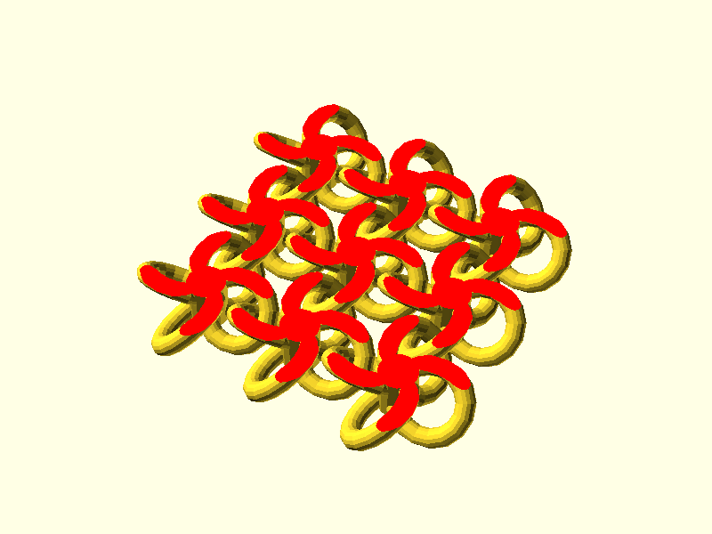
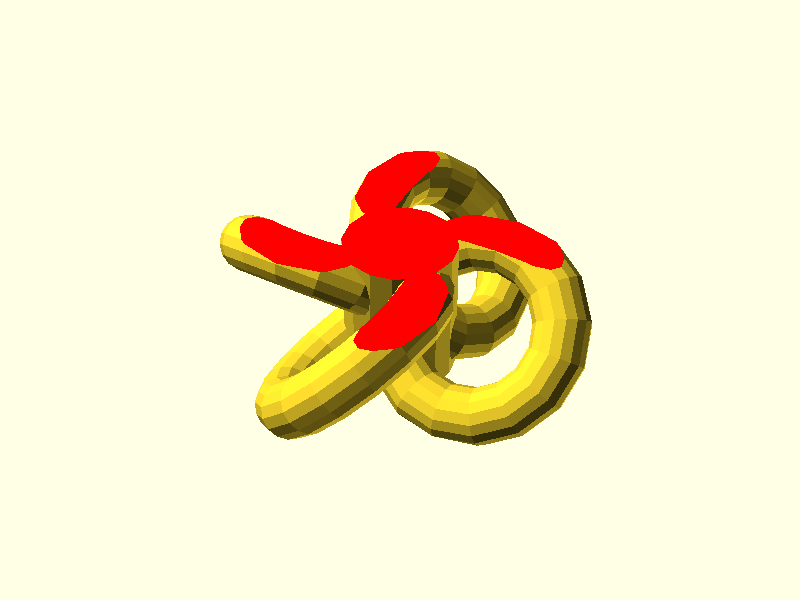
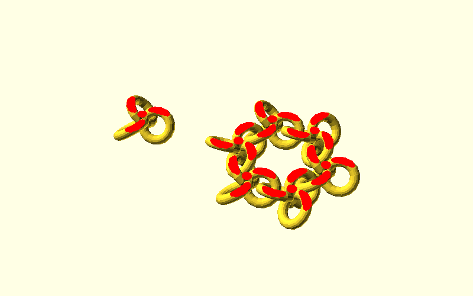

# linkmail-scad

An OpenSCAD library for print-in-place sheets of interlocking links, like
chainmail. The sheet prints flat in one piece, and each link comes off the
bed linked to its neighbours but free to move.



## Usage

```openscad
use <src/linkmail.scad>

square_mail(link_loop_rad = 3.5, link_circle_rad = 1, loop_skew = 45, cut_offset = 1,
            n = 3, m = 3, clearance = 0.4);
```

### `square_mail(link_loop_rad, link_circle_rad, loop_skew, cut_offset, n, m, clearance = 0.4)`

An `n` by `m` sheet of square links.

| Argument          | Meaning |
| ----------------- | ------- |
| `link_loop_rad`   | Radius of each loop, in mm. A link reaches twice this from its centre. |
| `link_circle_rad` | Radius of the round wire the loops are made of, in mm. |
| `loop_skew`       | How far each loop tilts out of the flat, in degrees. Neighbouring loops tilt opposite ways and pass through each other. |
| `cut_offset`      | How much to cut off the top and bottom of each link so it sits flat on the bed, in mm. Must be less than `2 * link_circle_rad`, or the cut severs the loops. |
| `clearance`       | The smallest gap between two neighbouring links, in mm. |

The links are placed as close together as `clearance` allows. If no spacing
leaves that much room, the render stops and says how much room there can be.
At a 45° skew with a 1 mm wire, a 3 mm loop radius leaves at most about
0.33 mm, and a 3.5 mm loop radius about 0.71 mm.

`square_mail_spacing(link_loop_rad, link_circle_rad, loop_skew, cut_offset, clearance)`
returns that spacing, for placing a sheet or sizing its border. It is in
`src/square_link.scad`: `use` that file too to call it.

### `square_link(link_loop_rad, link_circle_rad, loop_skew, cut_offset, fn = 16)`

A single link: four tilted loops around a hub, cut flat top and bottom.



### Triangle links

`triangle_link()` in `src/triangle_link.scad` makes a three-loop link, and
`tri_hex_link(link_circle_rad, link_loop_rad, link_spacing = 0.5)` places six
copies of its child in a ring. There is no triangle sheet yet, and the ring is
spaced by the older `link_spacing` factor, not by a clearance, so its gaps are
unchecked.



## Examples

- `examples/square_link_example.scad`: one square link.
- `examples/square_linkmail_example.scad`: a 3 by 3 sheet.
- `examples/triangle_link_example.scad`: a triangle link and a ring of six.

## How the spacing is found

`square_link_gap()` measures the smallest distance between the surfaces of two
square links a given distance apart: between the loops of one and the loops of
the other, and between the loops of one and the hub of the other. Diagonal
neighbours are not measured: for loop radii of 3 to 6 mm and skews of 30° to
60°, they were at least 2.3 mm further apart than side neighbours at the
chosen spacing. The gap rises and then falls as the links move apart, and the
spacing is the closest one at which it reaches `clearance`.

The rendered loops are polygons that sit inside the true round surfaces, so the
printed gap is a little larger than `clearance`: in the 3 by 3 example at
0.4 mm, the smallest gap in the exported mesh is 0.46 mm.

## Development

With [just](https://just.systems/), OpenSCAD and Python 3, `just test` runs the
geometry checks in `tests/test_linkmail.scad`, renders every example with
warnings as errors, checks that a cut too deep for the wire is refused, and
counts the links in the example sheet to make sure none fused. `just images`
renders the pictures in `assets/`.

## License

MIT. See [LICENSE](./LICENSE).
